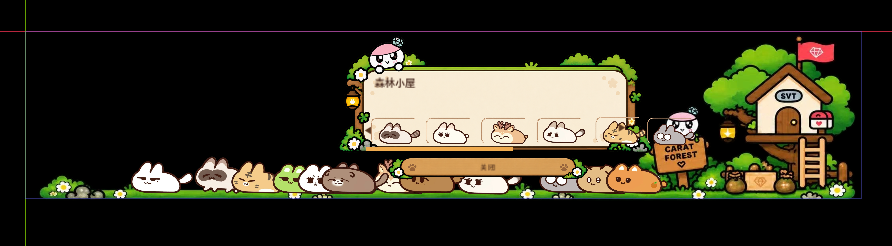

# Miniteen Forest Desktop Pet

一个使用 Godot 4 制作的桌面宠物养成原型。项目把日常键盘输入转化为金币，并通过阶段目标解锁不同宠物，让桌面陪伴与真实使用行为形成轻量循环。

## Windows 下载

**[下载 Windows 便携版 v1.0](https://github.com/chcccchi/miniteen-forest-desktop-pet/releases/tag/v1.0)**

下载后请先解压 ZIP，并保持文件夹完整；双击 `Launch Desktop Pet.bat` 即可运行。首次启动时 Windows 可能因未签名显示 SmartScreen 提示。

## 核心玩法

- 记录键盘输入次数，并按规则换算金币。
- 使用金币解锁不同宠物，形成持续养成目标。
- 宠物常驻屏幕底部，小屋界面承载解锁与管理功能。
- 支持置顶、透明窗口和鼠标穿透等桌面交互。

## 我的工作

- 设计“输入行为 - 金币产出 - 宠物解锁”的成长循环。
- 使用 Godot 搭建原型并处理全局热键、鼠标穿透、窗口层级、UI 布局和本地状态。
- 通过实际使用调整金币产出速度和阶段目标，避免目标过快完成或长期缺少反馈。
- 使用 AI 辅助拆解实现任务、定位报错；由我负责需求判断、测试复现、方案筛选和回归验证。

## 源码运行方式

1. 下载并解压 `project-source.zip`。
2. 使用 Godot 4.7 或兼容版本打开其中的 `project.godot`。
3. 运行主场景 `main.tscn`。
4. Windows 环境下体验置顶、透明窗口和鼠标穿透效果。

## 项目结构

- `main.gd`：主要逻辑。
- `main.tscn`：主场景与界面节点。
